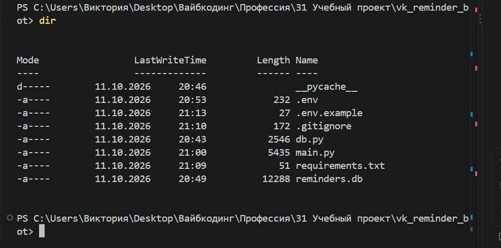
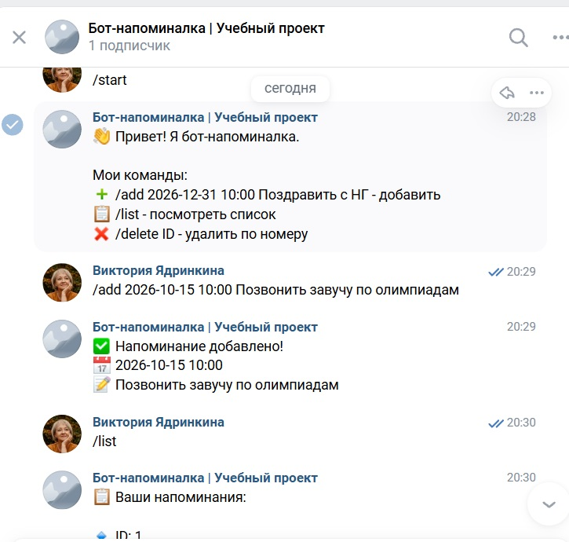
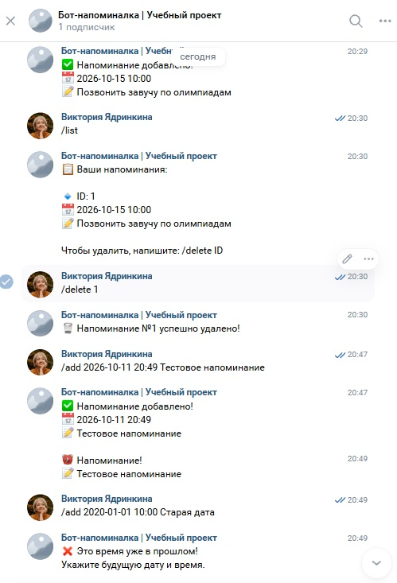
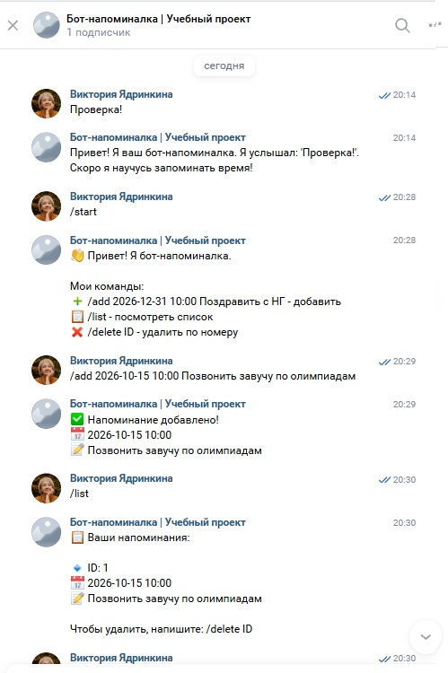

# Бот-напоминалка для ВКонтакте ⏰

Учебный проект курса «Профессия Вайб-кодер 3.0» (Задание 4, уровень ⭐⭐).
Бот принимает напоминания с датой и временем, хранит их в SQLite и **автоматически** присылает сообщение в назначенный момент.

## Почему выбран этот кейс
Проект вырос из реального запроса: во время практики по поиску клиентов заместитель директора школы рассказал(а), что в сезон олимпиад приходится постоянно открывать график работ и что-то забывается. Бот-напоминалка решает именно эту боль — и может быть адаптирован под график олимпиад.

## Возможности
- `/start` — справка и список команд
- `/add ГГГГ-ММ-ДД ЧЧ:ММ Текст` — добавить напоминание
- `/list` — посмотреть активные напоминания (с ID)
- `/delete ID` — удалить напоминание
- Автоматическая отправка в заданное время (планировщик проверяет базу каждые 30 секунд)
- Валидация ввода: неверный формат даты, прошедшее время
- Каждый пользователь видит только свои напоминания

## Стек
Python 3.11+, vk_api (Long Poll API), SQLite, APScheduler, python-dotenv

## Архитектура
- `main.py` — слой бота и планировщика: слушает события ВК (Long Poll), обрабатывает команды, запускает фоновую задачу `check_reminders` (APScheduler, интервал 30 сек).
- `db.py` — слой базы данных: все операции с SQLite (таблица `reminders`: id, user_id, text, remind_at, status).
- `.env` — секретный токен сообщества (в репозиторий не попадает, см. `.gitignore`).

## Запуск проекта
1. Установите зависимости:
   pip install -r requirements.txt
2. Создайте файл `.env` по образцу `.env.example`:
   VK_TOKEN=ваш_токен_сообщества_ВК
   (Токен: Управление сообществом → Работа с API → Ключи доступа; там же включите Long Poll API и тип события «Входящее сообщение».)
3. Запустите бота:
   python main.py
4. Напишите сообщению ВКонтакте команду `/start`.

## Пример использования
Пользователь: `/add 2026-10-15 10:00 Позвонить завучу по олимпиадам`
Бот: `✅ Напоминание добавлено! 📅 2026-10-15 10:00 ...`
В назначенное время бот сам присылает: `⏰ Напоминание! 📝 Позвонить завучу по олимпиадам`

## Скриншоты

## Примечания
- Бот живёт по времени компьютера, на котором запущен.
- Напоминания отправляются, пока процесс бота запущен; для боевого использования такой сервис размещают на сервере (VPS).
